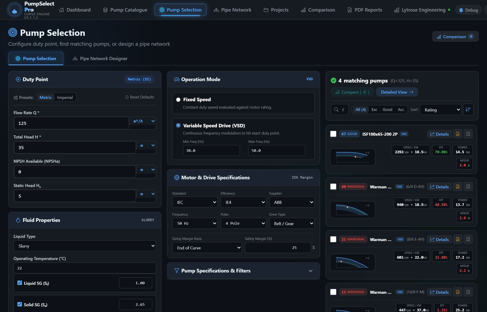
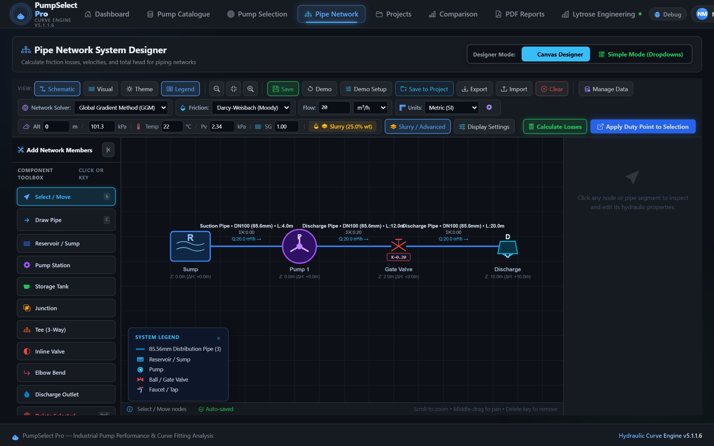
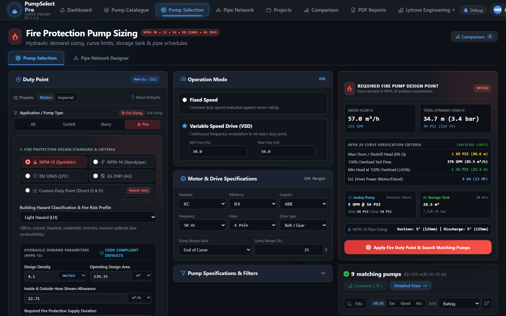
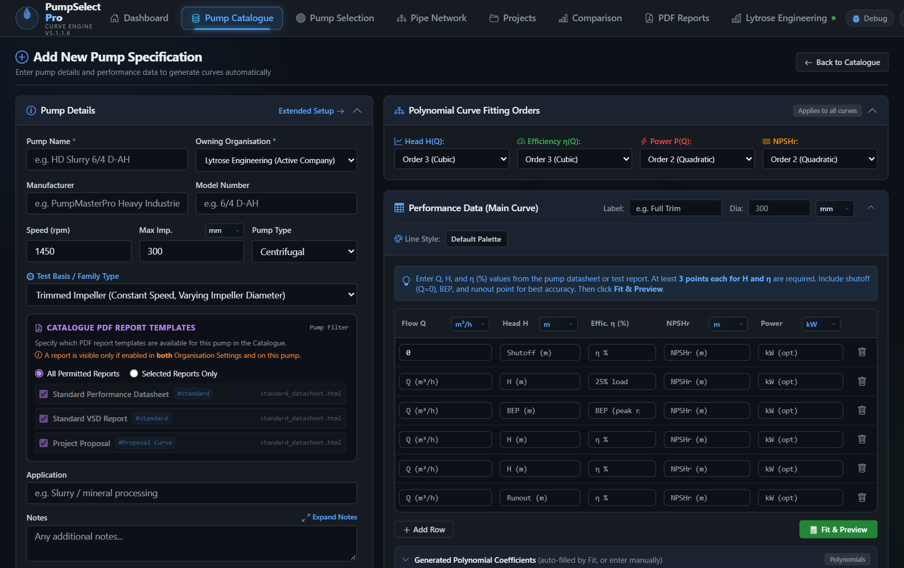
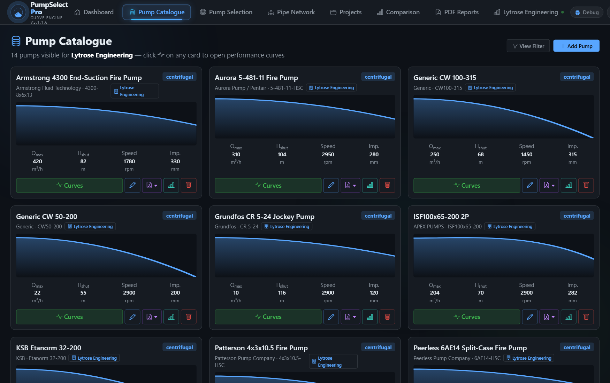
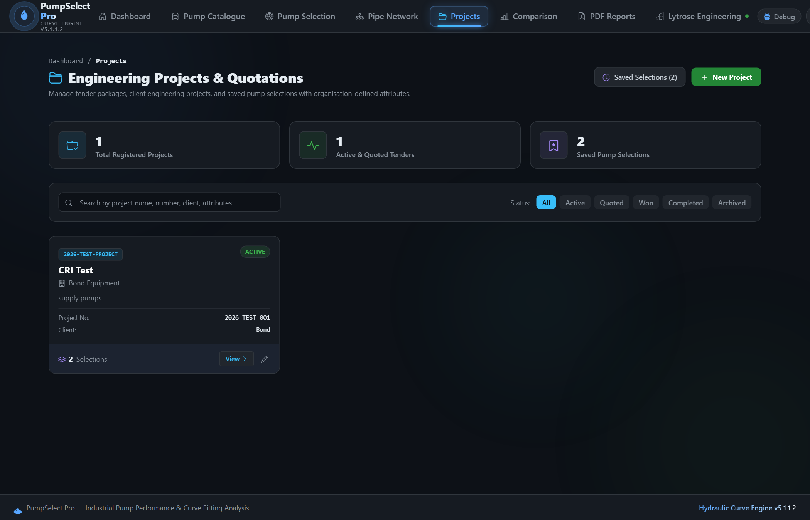
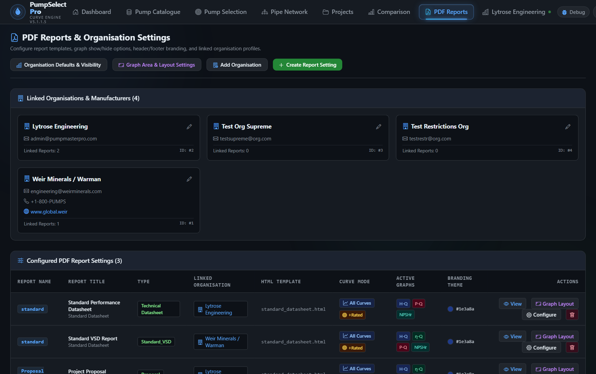

# PUMP MASTER PRO™ — Next-Generation Industrial Pump Sizing & Hydraulic Engineering Suite
**Web Application:** [pumpmasterpro.com](https://pumpmasterpro.com) | **Platform:** Cloud Engineering Suite | **Standards:** ISO 9906 • ANSI/HI 14.6 • API 610 • NFPA 20/13/14 • EN 12845 • AS 2941

---

## EXECUTIVE SUMMARY

> **"From Raw Duty Point to Publication-Grade Submittal in Under 3 Minutes."**

**Pump Master Pro** is the cloud-native hydraulic sizing, curve-fitting, and pipe network analysis platform built specifically for **Centrifugal Pump Manufacturers (OEMs)**, **EPC Contractors**, **Consulting Engineers**, **Fire Protection Designers**, and **Heavy Industrial Plants (Mining, Water, Chemical & Slurry)**.

Unlike rigid legacy tools that lock you into static third-party databases, **Pump Master Pro is 100% customizable**:
* **Add Your Own Pumps:** Register your own pump models, series, and multi-speed configurations.
* **Automated Curve Fitting:** Enter manufacturer test points ($Q, H, \eta, P, NPSHr$) and let the system fit high-order polynomial regression curves.
* **Interactive CAD & Schematic Pipe Network Designer:** Draw orthogonal and circuit schematic systems with Darcy-Weisbach and Colebrook-White friction solving.
* **Fire Protection Code Engine:** Automated hazard demand sizing (NFPA 13/14, EN 12845) with NFPA 20 certified curve boundaries and auxiliary jockey pump/tank sizing.
* **Bespoke Submittals:** Generate white-labeled A4 PDF datasheets with your corporate branding and logo.

---

## 100% CUSTOMIZABLE: ADD & MANAGE YOUR OWN PUMPS

| Customization Area | Capability & Flexibility |
| :--- | :--- |
| **Custom Pump Data Entry** | Add any centrifugal, slurry, or fire pump model. Define pump family, series, suction/discharge flange ratings, impeller trim diameter ranges (min, rated, max), design RPMs, and motor configurations. |
| **Automated Test Curve Digitization** | Enter raw test bench points. The mathematical regression engine automatically calculates best-fit curves ($R^2 > 0.998$) and affinity-law scaling for trimmed impellers and variable speed operation. |
| **Corporate White-Labeling** | Customize report headers, corporate logos, primary banner color schemes, technical notes, and warranty disclaimers on all PDF submittal packages. |
| **Bespoke Fluids & Fittings** | Create custom fluid libraries with tailored specific gravities ($S_m$), particle size distributions ($d_{50}$), slurry settling parameters, pipe roughness, and proprietary fitting $K$-factors. |

---

## CORE ENGINEERING MODULES & LIVE SCREENSHOTS

### 1. Intelligent Pump Sizing & Selection Engine
* **Multi-Parameter Search:** Filters thousands of pump curves instantly by Flow ($Q$), Head ($H$), and available NPSH.
* **Proximity to BEP:** Highlights Preferred Operating Regions (POR: 70–120% of BEP) and Allowable Operating Regions (AOR) to prevent premature bearing, seal, and impeller failure.
* **Speed & Impeller Affinity Laws:** Automatically generates trimmed diameter curves ($D/D_{max}$) with Karassik efficiency deratings and Variable Speed Drive (VFD/RPM) curves.

*Figure 1: Interactive duty point matching showing superimposed Head (H-Q), Efficiency (η-Q), Power (P-Q), and NPSHr curves with BEP proximity rating.*

---

### 2. CAD-Grade Pipe Network Designer — Schematic View & Flow Solver
* **Orthogonal Hydraulic Routing:** Clean horizontal-vertical CAD canvas with integrated elbows, inline valves, tees, and reservoirs.
* **Dual Perspectives:** Switch between orthogonal CAD canvas and clear Schematic Circuit representation displaying hydraulic components, node elevations, and velocities.
* **Rigorous Friction Solving:** Solves Darcy-Weisbach head loss using Colebrook-White friction factors iteratively—eliminating simplified Hazen-Williams limitations.
* **System Curve Overlay:** Automatically plots the parabolic system curve ($H_{sys} = H_{static} + k \cdot Q^2$) against pump curves to pinpoint exact operating intersection points.

*Figure 2: Pipe Network System Designer in Schematic View — Circuit diagram symbols, elevations, Darcy-Weisbach / Colebrook-White friction factors, and system curve overlays.*

---

### 3. Fire Protection Pump Sizing & NFPA 20 Code Compliance Engine
* **Hazard Classification Hydraulic Demand:** Code-compliant automatic calculations for NFPA 13 (Sprinklers: Light, Ordinary 1/2, Extra Hazard 1/2) with density/operating area and hose stream allowances, NFPA 14 (Standpipes: Class I, II, III riser counts), EN 12845 (LPC), and AS 2941.
* **NFPA 20 Certified Curve Boundaries:** Real-time enforcement of mandatory fire pump criteria: 100% rated capacity & head, minimum 65% rated head at 150% overload test flow, and maximum 140% shutoff (churn) pressure ceiling.
* **Automated Auxiliary Equipment Sizing:** Pressure-maintenance jockey pump sizing (rated flow & start/stop cut-in cut-out pressures), dedicated fire water storage tank / reservoir volume calculation (30 to 120 minutes), and NFPA 20 suction/discharge pipe schedules.
* **Driver Rating & Overload Protection:** Electric motor and diesel engine sizing with mandatory safety overload margins.

*Figure 3: Fire Protection Pump Sizing Tool — Automated hazard demand calculation (NFPA 13/14, EN 12845, AS 2941), certified NFPA 20 curve boundaries (140% shutoff, 150% overload), auxiliary jockey pump & tank calculations, and duty matching.*

---

### 4. Custom Pump Builder — Add Your Own Proprietary Pumps
* **Live Curve Fitting Form:** Add custom pump models with ease. Input raw manufacturer test bench points, specify impeller trim diameter ranges, define motor ratings and flange ratings, and preview fitted curves in real-time.

*Figure 4: Add new pump models with live interactive curve fitting, operating limits, and motor specifications.*

---

### 5. Centralized Pump Data Catalogue & Inventory
* **Fleet & Catalogue Management:** Searchable database of centrifugal, slurry, and fire pump models with one-click curve analysis, comparison, and datasheet generation.

*Figure 5: Centralized Pump Catalogue with multi-filter search, family grouping, and instant selection.*

---

### 6. Projects & Saved Selections Management
* **Complete Selection Snapshot:** In a single click, save the selected pump model, operating duty point ($Q, H, \eta, P, NPSHr$), fluid rheology, and the **entire CAD pipe network topology** directly into a project record.
* **Up to 10 Custom Organization Attributes:** Configure bespoke metadata per organization (e.g., Plant Area, Mine Site, Fluid Stream, Piping Class, Lead Engineer, Tender Reference, Budget Code).
* **Instant Workspace Reload:** Any team member can reopen a past saved selection with 1 click directly back into the live selection tool or CAD pipe canvas to re-simulate, modify parameters, or regenerate updated submittals without re-typing data.

*Figure 6: Centralized project repository displaying client details, tender references, custom metadata attributes, and saved pump selection histories.*

---

### 7. Technical Reports & PDF Submittal Engine
* **Pixel-Perfect Vector PDF Generation:** Dedicated Headless Chromium engine renders razor-sharp vector PDF files matching the on-screen browser preview 100% identically—eliminating blurry canvas captures or broken print layouts.
* **Flexible 1 to 4 Graph Stacking:** Configure 1, 2, 3, or 4 stacked performance charts ($H-Q$, Efficiency, Power, $NPSHr$) with customizable display sequence and height percentage splits.
* **Comprehensive Technical Sections:** Includes operating duty point badges, rated curve overlays, speed/trim isolines, complete construction & materials specification table, hydraulic design specs, and engineering approval remarks.
* **Multi-Supplier White-Labeling:** Customize header banners, footer notices, corporate logos, and primary brand theme colors per manufacturer or distributor.

*Figure 7: Customizable report builder allowing multi-chart sequence ordering, height splits, isoline styling, and corporate white-label branding.*

---

### 8. Slurry & High-Density Solids Engine
* **Settling Velocity Analysis:** Ferguson & Church equation calculation based on solids density ($S_s$), particle size ($d_{50}$ to $d_{90}$), and liquid carrier properties.
* **Deposition Velocity Limits:** Durand critical velocity ($V_c$) solving to prevent pipe sanding and line blockage.
* **Slurry Derating:** Automatically applies Head Ratio ($HR$) and Efficiency Ratio ($ER$) corrections to calculate actual slurry shaft brake power ($P_{shaft}$).

---

### 9. Viscous Fluid Modeling (ANSI/HI Method)
* **Hydraulic Institute Standard:** Incorporates ANSI/HI 9.6.7 correction procedures for viscous liquids up to thousands of centistokes (cSt).
* **Automated Derating Factors:** Computes $C_H$ (head correction), $C_Q$ (flow correction), and $C_\eta$ (efficiency correction) dynamically as user enters fluid viscosity and temperature.

---

## BUSINESS IMPACT & RETURN ON INVESTMENT (ROI)

| Metric | Traditional Methods (Manual/Excel) | With Pump Master Pro | Net Improvement |
| :--- | :--- | :--- | :--- |
| **Submittal Turnaround Time** | 2 to 4 hours per pump quotation | **Under 3 minutes** | **90% Time Reduction** |
| **Fire Protection Compliance** | Manual NFPA 20 curve tolerance verification and separate spreadsheet sizing for jockey pumps | **Instant NFPA 13/14/20, EN 12845 & AS 2941 automated verification** | **100% Code Compliance** |
| **Selection Accuracy** | Risk of manual formula/derating errors | **Validated Server-Side Solvers** | **Zero Calculation Error** |
| **Sales Conversion Rate** | Static text sheets / plain PDFs | **Interactive Visual Curves & Schematics** | **Higher Win Rates on Bids** |
| **Asset Reliability** | Unforeseen cavitation and early failure | **POR/AOR + NPSH Margin Verification** | **Reduced Warranty Claims** |

---

## ARCHITECTURE & INTELLECTUAL PROPERTY SECURITY

* **100% Cloud SaaS:** Zero desktop installations, DLL conflicts, or license dongles. Works seamlessly in any modern browser on Windows, Mac, Linux, and tablets.
* **Server-Side Intellectual Property Vault:** All proprietary equations (Darcy-Weisbach, Ferguson & Church settling, Durand velocity, Karassik trimming, and vapor pressure) execute strictly inside a hardened server-side calculation engine. Browsers never receive raw formulas.
* **Organization & Multi-Tenant Management:** Role-based permissions allow corporate administrators to manage teams, distribute catalogs, and govern permissions between Lead Engineers, Sales Reps, and Clients.

---

## CALL TO ACTION

### Ready to elevate your pump engineering and quotation workflow?

* **Live Platform:** [https://pumpmasterpro.com](https://pumpmasterpro.com)
* **Access Registration:** Visit the registration portal to request an organization workspace or personal engineering account.
* **Inquiries & Demonstrations:** Contact the engineering team for custom OEM catalog onboarding and enterprise team training.
